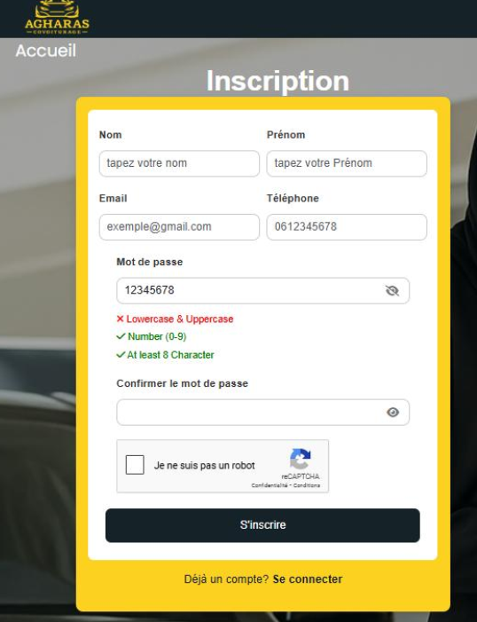
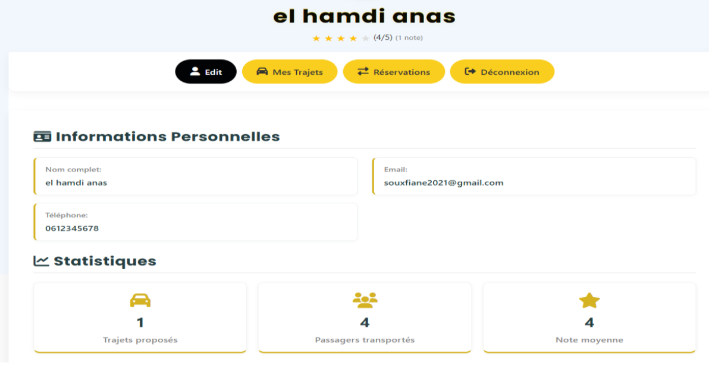
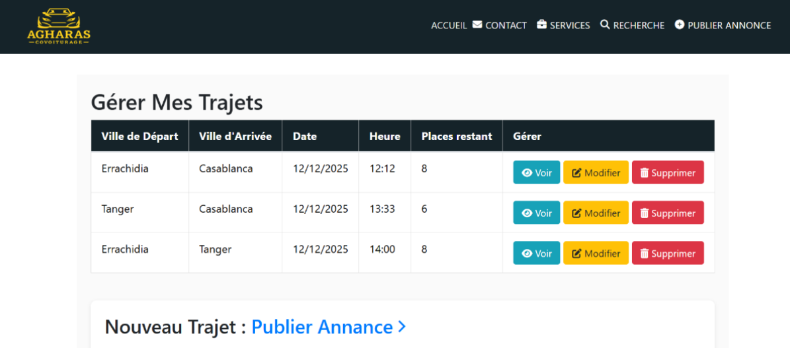
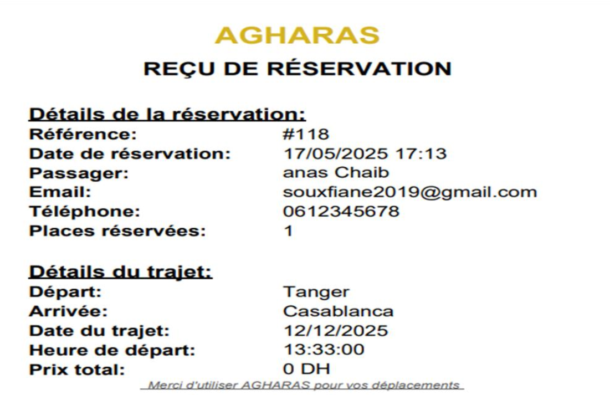
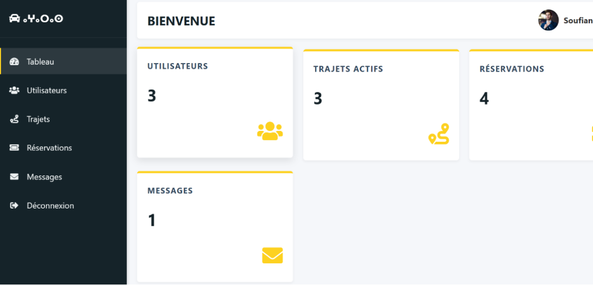
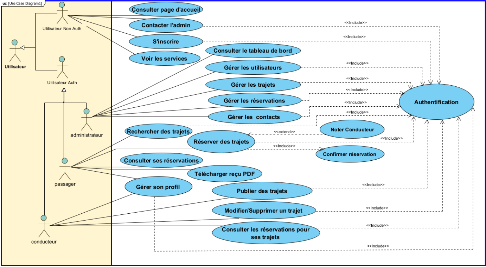
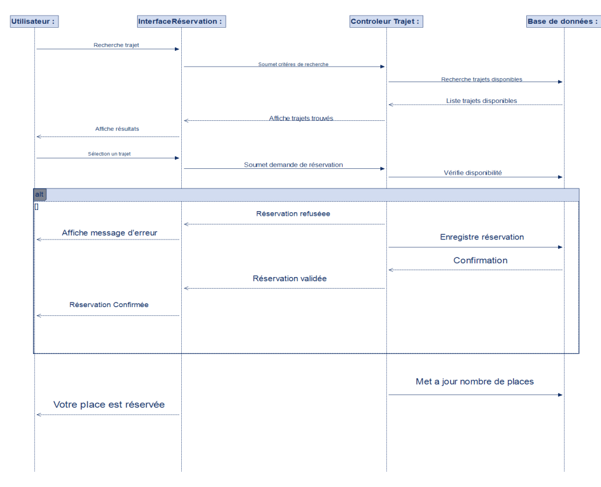
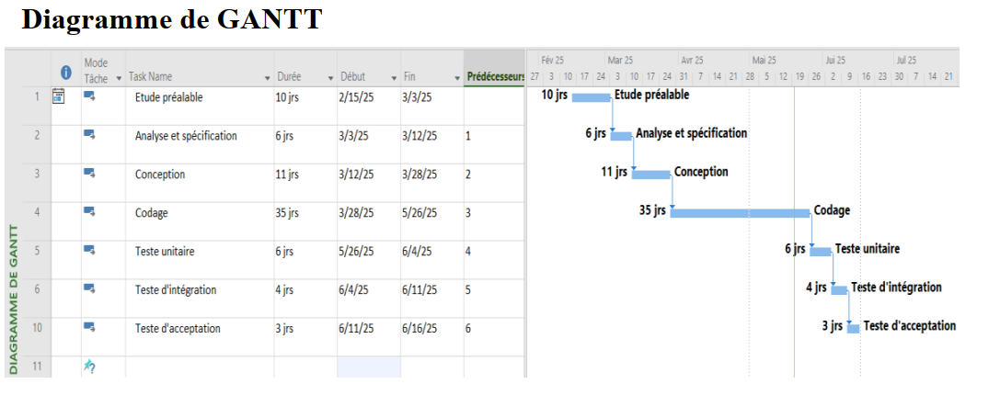

# 🚗 AGHARAS — Plateforme Web de Covoiturage avec Système de Recommandation basé sur l'IA

**AGHARAS** est une plateforme web dynamique de covoiturage conçue et développée par SOUFIAN-haskouk.

---

## 📌 Présentation du Projet
Face aux défis croissants du transport urbain et interurbain (embouteillages, coûts élevés des véhicules individuels, rareté des transports en commun), **AGHARAS** propose une solution numérique collaborative, sécurisée et intuitive[cite: 11, 13]. La plateforme met en relation directe les conducteurs et les passagers pour partager les frais de trajet tout en réduisant l'empreinte écologique

---

## 📸 qulleque  Interfaces & Diagrams (Screenshots)

### 🖥️ Application Web & Espace Utilisateur
| Page d'Accueil | Inscription | Profil Utilisateur |
| :---: | :---: | :---: |
|  |  |  |

| Gestion des Trajets | Reçu de Réservation (PDF) | Espace Administrateur |
| :---: | :---: | :---: |
|  |  |  |

---

### 📊 Modélisation UML & Planification
| Diagramme de Cas d'Utilisation (Use Case) | Diagramme de Séquence (Réservation) | Planning (Gantt) |
| :---: | :---: | :---: |
|  |  |  |

---

## 🌟 Fonctionnalités Principales

### 👤 1. Gestion des Utilisateurs & Sécurité
* **Inscription & Authentification :** Création de comptes sécurisée (Passager / Conducteur) avec validation des mots de passe et protection anti-robot (`reCAPTCHA`)
* **Récupération de mot de passe :** Système de réinitialisation sécurisé par lien envoyé par e-mail
* **Espace Personnel (Profil) :** Modification des informations personnelles et consultation des statistiques individuelles (trajets proposés, passagers transportés, note moyenne)[cite: 50].

### 🚗 2. Gestion des Trajets
* **Publication d'annonces :** Les conducteurs peuvent publier de nouveaux trajets (ville de départ, d'arrivée, date, heure, prix, places disponibles et type de véhicule)
* **Recherche avancée :** Recherche multi-critères dynamique pour les passagers (départ, arrivée, date)[cite: 42].
* **Gestion et Suivi :** Les conducteurs peuvent modifier, supprimer ou suivre l'état de leurs annonces et consulter les réservations associées

### 🎫 3. Réservations & Reçu PDF
* **Processus de réservation :** Demande de réservation de places avec mise à jour automatique de la disponibilité[cite: 42, 43].
* **Génération de Reçu PDF :** Intégration de la bibliothèque **TCPDF** pour télécharger un reçu officiel de réservation[cite: 44].
* **Évaluation des conducteurs :** Système de notation par étoiles (1 à 5) et commentaires après chaque trajet[cite: 24, 43].

### 🛠️ 4. Administration Générale
* **Tableau de bord Admin :** Vue d'ensemble statistique (utilisateurs, trajets actifs, réservations, messages)[cite: 48].
* **Modération :** Gestion complète des utilisateurs, des annonces de trajets, des réservations et des messages de contact[cite: 49, 50, 51].

---

## 🛠️ Architecture & Technologies Utilisées

Le projet repose sur une architecture web dynamique répartie comme suit :

* **Frontend :** HTML5, CSS3, JavaScript, **Bootstrap** (pour une interface ergonomique et responsive)[cite: 34, 38].
* **Backend :** **PHP** (côté serveur, gestion des sessions et logique métier)[cite: 36].
* **Module Intelligent / Données :** Scripts **Python** dédiés au prétraitement des données et au module de recommandation de trajets
* **Base de Données :** **MySQL** (gérée via PhpMyAdmin / XAMPP)
* **Génération Documentaire :** TCPDF[cite: 59].
* **Modélisation UML :** Conçu à l'aide de **Visual Paradigm** et **Modelio** (Diagrammes de cas d'utilisation, classes, séquences, activités et états-transitions)
* **Contrôle de Version :** Git & GitHub

---

## 📂 Structure du Projet

```text
AGHARAS/
│
├── docs/                            #  diagrammes UML et rapports
├── admin/                           # Interface d'administration
│   └── includes/
│       ├── admin_login.php
│       ├── contact.php
│       ├── dashboard.php
│       ├── delete_reservation.php
│       ├── delete_trajet.php
│       ├── delete_user.php
│       ├── edit_reservation.php
│       ├── edit_trajet.php
│       ├── edit_user.php
│       ├── login.php
│       ├── logout.php
│       ├── manage_contacts.php
│       ├── manage_reservations.php
│       ├── manage_trajets.php
│       ├── manage_users.php
│       ├── test_db.php
│       └── update_status.php
│
├── forUs/                         # Base de données, scripts SQL et ressources
│   └── screenshots/                 # Captures d'écran et schémas UML
│
├── libs/                           # Bibliothèques externes
│   └── tcpdf/                      # Bibliothèque TCPDF pour génération PDF
│
│
├── css/                            # Feuilles de style
│
│
├── js/                             # Scripts JavaScript
│
│
├── pages/                          # Pages principales du site , start with index.php avant de user cree compte
│ 
│    └──── trips/                          # Gestion des trajets (après inscription)
│    │  ├── api/                        # API pour les trajets
│    │  ├── Accueil.php
│    │  ├── add.php
│    │  ├── annuler_reservation_admin.php
│    │  ├── annuler_reservation.php
│    │  ├── confirmation.php
│    │  ├── confirmation1.php
│    │  ├── contact.php
│    │  ├── creer_trajet.php
│    │  ├── deconnexion.php
│    │  ├── edit_profile.php
│    │  ├── generate_pdf.php
│    │  ├── list.php
│    │  ├── logout_confirm.php
│    │  ├── mes_reservations.php
│    │  └── mes_trajets_conducteur.php
│    │
│    │
│    └──── S_R/                            # Dossier système/réservations 
│      ├──  data_extractor.py
│      ├── recommendation_api.py
│      ├── recommendation_model.py 
│      └── training_data/                 # Données d'entraînement pour le système de recommandation
│        ├── available_rides.csv
│        ├── data_summary.json
│        ├── user_profiles.csv
│        └── user_ride_interactions.csv
│
│
│   └── Fichiers racine :
    ├── bocc.php
    ├── contact.php
    ├── footer.php
    ├── forgetpassword.php
    ├── get_recommendations.php
    ├── index.php //same accueil en trips/
    ├── inscription.php
    ├── inscription1.php
    ├── login.php
    ├── reset_password.php
    ├── sendgrid_config.php
    └── service.php
│
├── vendor/  
├── LICENSE                          # Fichier de licence et droits d'auteur
└── README.md                        # Documentation officielle du projet
